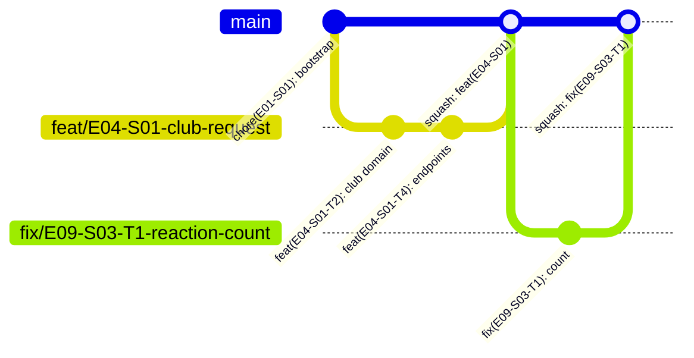
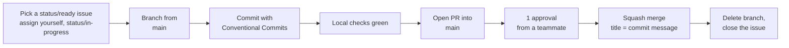

# Contributing to Virtual Clubroom (team UNIX_CLUB)

---

## 1. Repository layout and golden rules

- **Repository:** [`42-UNIX-CLUB/vclubroom`](https://github.com/42-UNIX-CLUB/vclubroom), private. Until the hackathon ended (2026-10-19), this code lived in `UNIX_CLUB/` of the hackathon repository `megyant/Hackathon_SA_2026`. That copy stays as the submission; its history was kept here, with the paths moved to the root.
- **Integration branch:** **`main`**. It must always build and be demo-able: the demo server deploys it (`deploy/deploy.sh`).
- **`main` changes only through squash-merged PRs.** Never push to it directly; the `pre-push` hook enforces this.
- **Backlog:** [`vclubroom/vclubroom`](https://tickets.ensui.dev/vclubroom/vclubroom) in our Forgejo (E18): epics, stories, tasks, bugs and chores, each an issue titled with its ID (`E04-S01 · …`). A story depends on its tasks and an epic on its stories, so they show their state and close after them. The GitHub Project is no longer updated.



---

## 2. Branches

### 2.1 Format

```text
<type>/<ID>-<short-desc>
```

| Part | Rule | Examples |
|------|------|----------|
| `<type>` | A Conventional Commits type: `feat`, `fix`, `docs`, `style`, `refactor`, `perf`, `test`, `build`, `ci`, `chore`, `revert` | `feat`, `fix` |
| `<ID>` | The backlog item the branch delivers: **task** `E04-S01-T3`, **story** `E04-S01` or **epic** `E04`, as in its Forgejo issue's title. A bug or chore without one takes the ID of the story or epic it belongs to | `E04-S01` |
| `<short-desc>` | kebab-case, lowercase `a-z0-9-`, ≤ 40 characters | `club-creation-request` |

**Examples**

```text
feat/E04-S01-club-creation-request
feat/E10-S02-T4-chat-room-ui
fix/E09-S03-T1-reaction-count
docs/E16-S05-readme-screenshots
chore/E01-S01-compose-files
```

**Granularity.** One branch per **story** by default, which gives PRs that are big enough to be useful and small enough to review. Use a **task** branch when a story is split between people (e.g. BE and FE). Use an **epic** branch only for docs or chores that span a whole epic.

### 2.2 Commands

```bash
git fetch origin
git switch -c feat/E04-S01-club-creation-request origin/main
git push -u origin feat/E04-S01-club-creation-request
```

### 2.3 Lifetime

- Branch from the **latest** `origin/main`.
- Keep branches short-lived (hours, not days). Rebase on `main` before opening or updating a PR:
  ```bash
  git fetch origin && git rebase origin/main
  git push --force-with-lease
  ```
- Delete the branch after the squash merge (GitHub button, or `git push origin --delete '<branch>'`).

---

## 3. Commits: Conventional Commits 1.0.0

Specification: <https://www.conventionalcommits.org/en/v1.0.0/>

```text
<type>(<ID>)[!]: <description>

[optional body: what and why, wrapped at ~72 chars]

[optional footer(s)]
```

- **Scope = backlog ID** (R-28). Rule of thumb: **copy `type(ID)` from your branch name**, or use the specific task ID you are working on (`E04-S01-T4`).
- **Description:** imperative mood, lowercase start, no trailing period, ≤ 100 characters ("add …", "fix …", not "added …").
- **Breaking change:** `!` after the scope and/or a `BREAKING CHANGE:` footer (e.g. renaming a REST field the frontend uses).
- **Footers:** `Refs: E04-S02` for related items, `Co-authored-by: Name <email>` when pairing.

| Type | Use for |
|------|---------|
| `feat` | A user-visible capability (endpoint, page, behaviour) |
| `fix` | A bug fix |
| `docs` | Documentation only (README, docs/, comments) |
| `style` | Formatting only, no logic change |
| `refactor` | Code change that neither fixes a bug nor adds a feature |
| `perf` | Performance improvement |
| `test` | Adding or fixing tests only |
| `build` | Build system or dependencies (`pom.xml`, `package.json`, Dockerfiles) |
| `ci` | CI configuration |
| `chore` | Maintenance that doesn't touch src or tests (compose, scripts, config) |
| `revert` | Reverting a previous commit |

**Good**

```text
feat(E04-S01-T4): add club creation request endpoint
fix(E09-S03-T1): count reactions per emoji instead of per user
feat(E07-S02)!: return 202 with request id for approval clubs

BREAKING CHANGE: POST /api/clubs/{id}/join now returns {status, membershipId, requestId}.
docs(E16-S05): add screenshots and run instructions to README
test(E05-S01-T4): cover archived-club write denial in access matrix
build(E01-S02-T1): add spring-modulith 1.4.13 BOM
```

**Bad**

```text
update stuff                       ← no type, no scope, vague
feat: club                         ← missing ID scope, not descriptive
Feat(E04-S01): Added endpoint.     ← capitalised type, past tense, trailing period
feat(club-module): add endpoint    ← scope must be a backlog ID (R-28)
```

---

## 4. Pull requests

### 4.1 Flow



1. **Target:** `main`.
2. **Title** = the squash commit message, a valid Conventional Commit for the **story** (or task):
   `feat(E04-S01): request club creation`
3. **Description:** use the template below.
4. **Review:** at least **one** approval from another team member. Reviews have priority over new work; aim for under 30 minutes.
5. **Merge:** **Squash and merge** (D-38). Check that GitHub's proposed commit title is still your PR title.
6. **After merge:** delete the branch, then close the Forgejo issue with a comment linking the PR. Its story or epic can close once all it depends on is closed. If backend DTOs changed, the merger regenerates frontend types in a follow-up `build(<ID>): regenerate api types` commit (§6.3).

> **No branch protection:** GitHub Free has no protected branches or rulesets for private repositories, so the rules above are conventions, backed by the local hooks (§5). The repository only allows squash merging (Settings → General → Pull Requests). To squash locally instead:
> ```bash
> git switch main && git pull
> git merge --squash feat/E04-S01-club-creation-request
> git commit -m "feat(E04-S01): request club creation"
> ALLOW_MAIN_PUSH=1 git push
> ```

### 4.2 PR description template (copy-paste)

```markdown
## What
<!-- One or two sentences. Link the Forgejo issue(s). -->
Implements E04-S01 (tasks T1–T6): students can request the creation of a club.
Forgejo: vclubroom/vclubroom#59

## How
<!-- Key design points, module(s) touched, anything reviewers should look at first. -->

## How to test
<!-- Exact steps / curl / UI path. -->
1. Log in as a student → /clubs/new → submit
2. Log in as admin → /admin/approvals → request is listed

## Checklist (Definition of Done)
- [ ] Acceptance criteria of the story are met
- [ ] Backend: `./mvnw verify` green (includes ModularityTests)
- [ ] Frontend: `npm run lint && npm test && npm run build` green
- [ ] New/changed endpoints visible in Swagger; `schema.d.ts` regenerated if DTOs changed
- [ ] Flyway migration added (timestamp version) if the schema changed; no edits to applied migrations
- [ ] No secrets (`.env` stays local)
- [ ] Docs/decision log updated if a design decision changed
```

### 4.3 Size

- Aim for **< 400 changed lines** (generated `schema.d.ts` excluded).
- Split BE and FE into separate PRs when they are owned by different people. Merge the BE stub first (contract-first, §6.2).

---

## 5. Local Git hooks (R-30)

The hooks are dependency-free bash. They are committed in `.githooks/` and enabled **once per clone**:

```bash
git config core.hooksPath .githooks
chmod +x .githooks/*
```

### 5.1 `.githooks/commit-msg`

```bash
#!/usr/bin/env bash
# Conventional Commits with a backlog-ID scope (D-37, R-28).
set -euo pipefail
header="$(head -n1 "$1")"

# Allow Git-generated messages.
if [[ "$header" =~ ^(Merge\ |Revert\ \"|fixup!\ |squash!\ ) ]]; then
  exit 0
fi

types='feat|fix|docs|style|refactor|perf|test|build|ci|chore|revert'
id='E[0-9]{2}(-S[0-9]{2}(-T[0-9]+)?)?'
pattern="^(${types})\((${id})\)!?: [^A-Z].{0,99}$"

if [[ ! "$header" =~ $pattern ]]; then
  echo "✖ Invalid commit message header:"
  echo "    $header"
  echo "  Expected: <type>(<ID>)[!]: <description>   e.g.  feat(E04-S01): add club creation endpoint"
  echo "  Types: ${types//|/, }   ID: E04 | E04-S01 | E04-S01-T3"
  exit 1
fi
```

### 5.2 `.githooks/pre-commit`

```bash
#!/usr/bin/env bash
# Never commit .env files (secrets).
set -euo pipefail
if git diff --cached --name-only | grep -Eq '(^|/)\.env$'; then
  echo "✖ Refusing to commit a .env file (secrets). Use .env.example for documentation."
  exit 1
fi
```

### 5.3 `.githooks/pre-push`

```bash
#!/usr/bin/env bash
# Branch naming (D-36) and protection of main.
set -euo pipefail
zero='0000000000000000000000000000000000000000'
types='feat|fix|docs|style|refactor|perf|test|build|ci|chore|revert'
id='E[0-9]{2}(-S[0-9]{2}(-T[0-9]+)?)?'
feature="^(${types})/(${id})-[a-z0-9]+(-[a-z0-9]+)*$"

while read -r local_ref local_sha remote_ref remote_sha; do
  [[ "$remote_ref" == refs/heads/* ]] || continue
  [[ "$local_sha" == "$zero" ]] && continue            # branch deletion
  branch="${remote_ref#refs/heads/}"

  if [[ "$branch" == "main" && "${ALLOW_MAIN_PUSH:-0}" != "1" ]]; then
    echo "✖ main is updated through squash-merged PRs."
    echo "  (Bootstrap or local squash merge: ALLOW_MAIN_PUSH=1 git push …)"
    exit 1
  fi
  if [[ "$branch" != "main" && ! "$branch" =~ $feature ]]; then
    echo "✖ Branch name '$branch' does not match <type>/<ID>-<short-desc>"
    echo "  e.g. feat/E04-S01-club-creation-request"
    exit 1
  fi
done
```

---

## 6. Working agreements

### 6.1 Definition of Ready (before picking an item)

- [ ] The item is a Forgejo issue with an ID, an assignee and acceptance criteria.
- [ ] Its dependencies are merged, or a stub or contract exists (§6.2).
- [ ] The design reference (module doc section) is known.

### 6.2 Contract-first between backend and frontend

1. The backend owner merges the **controller and DTO stubs** first (fixed or fake data is fine), titled `feat(<ID>): add <endpoint> contract`.
2. The frontend regenerates types (`npm run api:types`) and builds against the stub.
3. The real implementation replaces the stub without changing the DTOs. If it must change them, mark the commit `!` and tell the frontend owner.

### 6.3 Generated files

- `frontend/src/shared/api/schema.d.ts` is **generated**. Never hand-edit it or hand-resolve conflicts in it: regenerate it from a running backend on the merged `main`.

### 6.4 Database migrations

- One folder per module (`db/migration/<module>/`), version = timestamp `V<yyyyMMddHHmm>__<description>.sql` (no collisions between three people).
- **Never edit a migration that is already merged.** Add a new one. Wipe your local DB if needed: `docker compose … down -v`.

### 6.5 Module ownership and boundaries

- Each module has a primary owner (the `track/…` labels follow the hackathon's split). Others may contribute, but ping the owner.
- Never import another module's internal packages. Spring Modulith's `ModularityTests` fails the build if you do (frontend: ESLint feature boundaries).

### 6.6 Secrets

- `.env` is never committed (hook). Share secrets through a private channel or password manager.
- Rotate the Resend key and 42 secret if they ever leak.

### 6.7 Definition of Done (per story)

- [ ] Acceptance criteria demonstrably met (manual test steps in the PR).
- [ ] Tests from the story's test task pass; `./mvnw verify` and the frontend checks are green.
- [ ] Squash-merged into `main`; the integration branch still starts with `docker compose` and the app runs.
- [ ] Its Forgejo issue is closed, with the PR linked; its tasks were closed before it.

### 6.8 Communication rhythm

Work is planned in **release milestones** in Forgejo (`v1.1.0`, `v1.2.0`, …): each issue belongs to the release it ships in.

| When | What |
|------|------|
| Starting work on a release | Short sync: pick issues from its milestone, check blockers, confirm API contracts |
| Every merge to `main` | Short message in the team chat: "merged feat(E04-S01), regenerate types" |
| Blocked > 20 minutes | Ask immediately; pair if needed |
| Before tagging a release | Everyone pulls `main` and checks the release's issues work together; then the release is tagged and deployed |

---

## 7. Deploying

The demo server keeps its own clone and deploys the latest `main` with `deploy/deploy.sh`, as described in [09-deployment §11.2](https://github.com/42-UNIX-CLUB/vclubroom-docs/blob/main/docs/09-deployment.md) in the docs repository. Merge to `main` first, then run it there.
