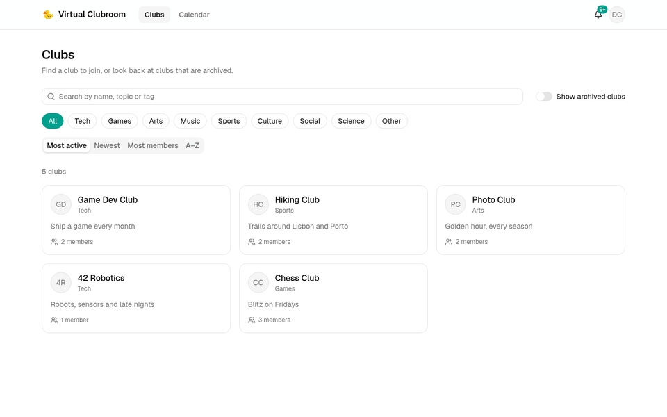
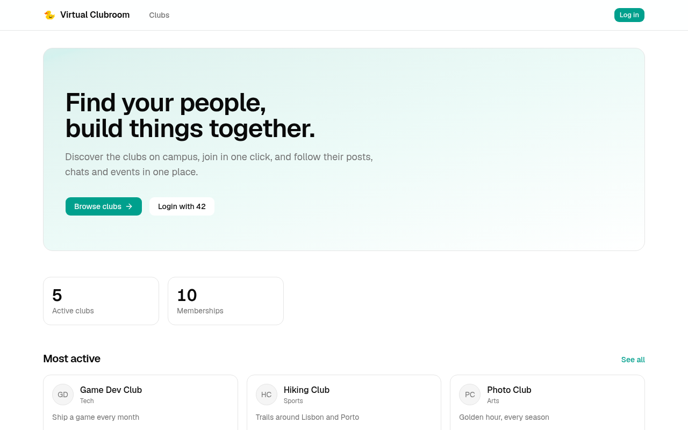
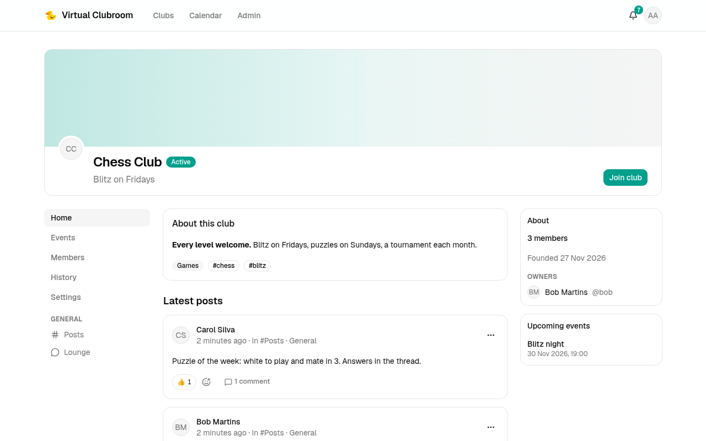
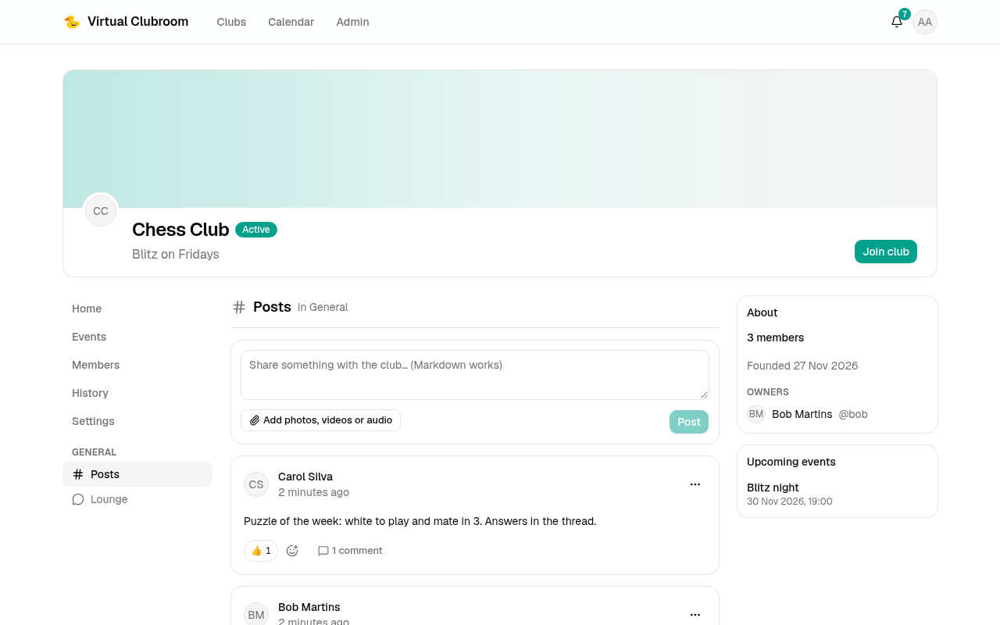
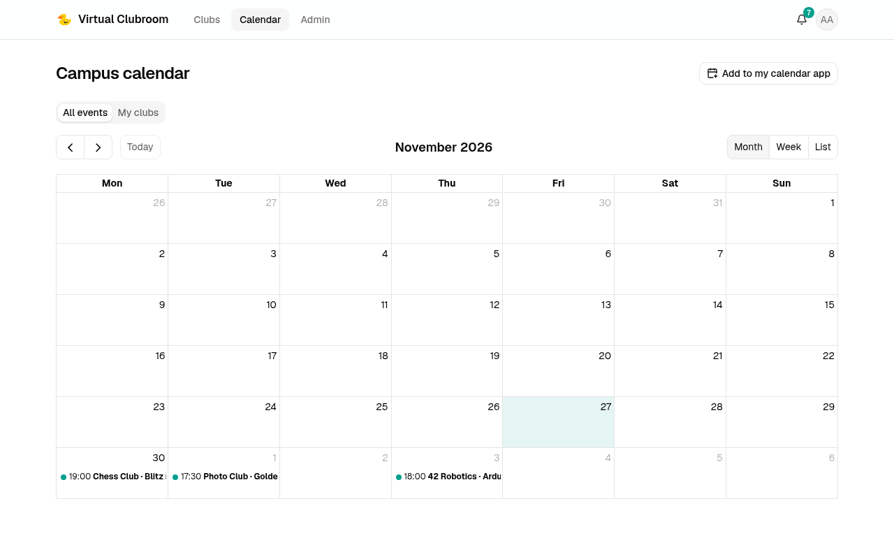
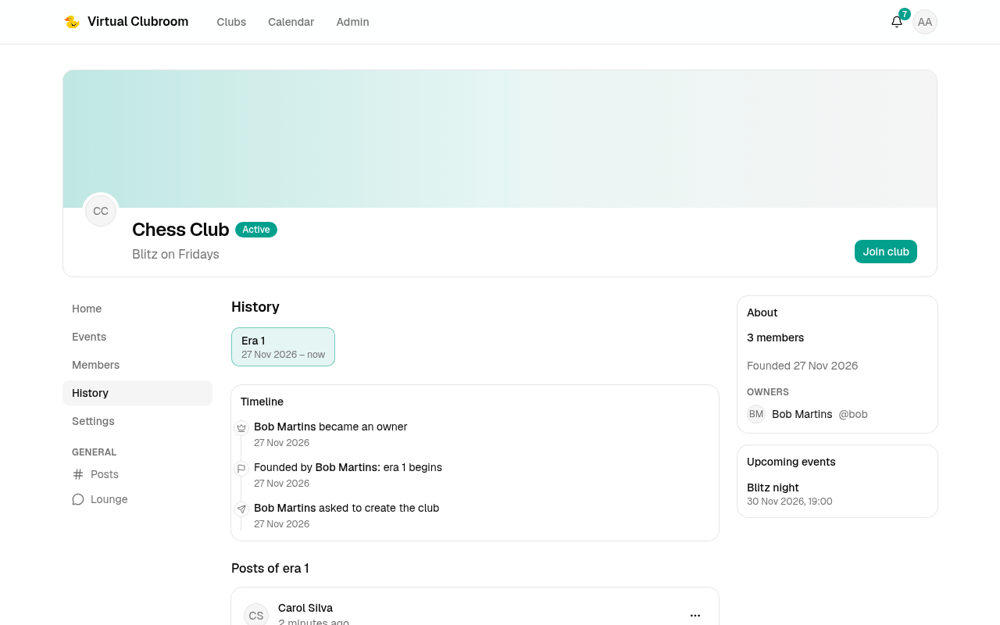
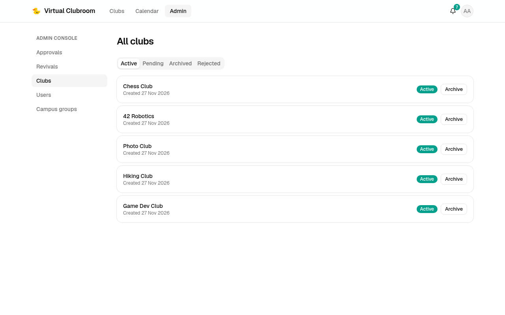

# Virtual Clubroom — UNIX_CLUB

> Discover, join and run 42 Portugal's student clubs, and keep them alive across generations.

**Live demo:** <https://42clubroom.ensui.dev> · **Team:** UNIX_CLUB (see [Team](#team))



## Why

Clubs are hard to find, their information is scattered, and a club disappears when its members graduate.
Virtual Clubroom gives every club its own space, makes joining a three-click flow, and keeps clubs alive through
co-ownership, ownership transfer, archival and history in eras.

## Features

| Subject requirement | Status | Where |
|---|---|---|
| Roles: owner, member, non-member, admin | ✅ | Every club page adapts to who is looking |
| Login with 42 intra, and with a password | ✅ | `/login` |
| Main landing page | ✅ | `/` |
| Join clubs through the site (open or on approval) | ✅ | Club page › **Join** |
| Club pages, and requesting a new club (admin approval) | ✅ | `/clubs/new`, `/c/<club>` |
| Posts with images, videos and audio | ✅ | Club › **Posts** |
| Comments with replies, and emoji reactions | ✅ | Under every post |
| Event calendar: per club and campus-wide | ✅ | `/calendar`, Club › **Events** |
| Ownership transfer and co-owners | ✅ | Club › Settings › **Ownership** |
| Club archival (everything stays readable) | ✅ | Admin › **All clubs** |
| Club history: eras, timeline, all past posts and comments | ✅ | Club › **History** |
| Community spaces with read/write rules | ✅ | Club sidebar |
| Custom club roles and permissions | ✅ | Club › Settings › **Roles** |
| Event RSVPs | ✅ | An event's page |
| Real-time chat | ✅ | A club's chat channels |
| Notifications, in the app and by email | ✅ | The bell, Settings › **Notifications** |
| Reviving an archived club | ✅ | An archived club's page, Admin › **Revivals** |
| Support tickets, answered by the team | ✅ | `/support` |

## Screenshots

| | |
|---|---|
|  |  |
|  |  |
|  |  |

## Tech stack

- **Backend:** Java 21, Spring Boot 3.5, Spring Modulith (a modular monolith whose module boundaries are verified by a test, events through a transactional outbox), Spring Security (OAuth2 login with 42, sessions in Redis), JPA and Flyway.
- **Frontend:** React 19, TypeScript, Vite, TanStack Query, React Router, Tailwind CSS v4 and shadcn/ui, FullCalendar.
- **Data and infrastructure:** PostgreSQL 17, Redis 8, SeaweedFS (S3-compatible storage), Docker Compose, nginx, Cloudflare Tunnel.

## Architecture

- **15 modules** (identity, club, membership, space, forum, chat, media, calendar, discovery, history, support, …) and a shared kernel. The 13 that keep data each have their own database schema; `realtime` and `ops` keep none. Spring Modulith's test fails the build if one module reaches into another's internals.
- **Events between modules** go through an outbox table in PostgreSQL: approving a club creates its owner, its spaces, its directory card and its first timeline entry, each in its own transaction, retried until it succeeds.
- **Stateless backend instances:** sessions live in Redis, so the demo runs two backend replicas behind nginx.
- **Media go straight to object storage:** the browser uploads with a presigned URL, and the backend only checks the result.
- **Read models** serve the public directory and the club timeline, so heavy reads never touch the write tables.

## Run it

### With Docker (production-like)

```bash
cp .env.example .env     # set APP_PUBLIC_URL=http://localhost:8080 and COOKIE_SECURE=false;
                         # FT_CLIENT_ID / FT_CLIENT_SECRET for Login with 42 (the password login works without)
deploy/seaweedfs/render-s3-config.sh      # storage credentials from .env (needs a non-default S3_SECRET_KEY)
docker compose -f compose.yaml -f compose.prod.yaml --profile demo up -d --build
```

Open <http://localhost:8080> and log in with the admin account from `.env` (`APP_BOOTSTRAP_ADMIN_USERNAME` / `APP_BOOTSTRAP_ADMIN_PASSWORD`).

### For development

You need JDK 21, Node.js 24 and Docker with Compose v2. The dev stack uses ports 5173, 8080, 5432, 6379, 8333, 1025 and 8025.

```bash
cp .env.example .env                                           # the defaults work for development
docker compose -f compose.yaml -f compose.dev.yaml up -d      # PostgreSQL, Redis, SeaweedFS, Mailpit
```

Then, in two terminals, from the repository root:

```bash
cd backend && ./run-dev.sh              # Spring Boot on :8080, dev profile, emails to Mailpit
cd frontend && npm ci && npm run dev    # Vite on :5173, proxying the API, WebSocket and media to the backend
```

Open <http://localhost:5173> and log in with the password form: `admin` / `change-me-admin` (`APP_BOOTSTRAP_ADMIN_USERNAME` / `APP_BOOTSTRAP_ADMIN_PASSWORD` in `.env`).

- **Login with 42** needs your own 42 OAuth application: set `FT_CLIENT_ID` and `FT_CLIENT_SECRET` in `.env`, with the redirect URI `http://localhost:5173/login/oauth2/code/fortytwo`.
- **Emails** land in Mailpit: <http://localhost:8025>.
- **Support tickets** are printed in the backend's log instead of going to a tracker (`TICKETS_TRACKER=log`).

Tests: `./mvnw verify` in `backend/` (Testcontainers needs Docker), and `npm run lint && npm test && npm run build` in `frontend/`.

## Contributing

1. **Access:** ask the team for this repository, the design docs ([`42-UNIX-CLUB/vclubroom-docs`](https://github.com/42-UNIX-CLUB/vclubroom-docs), private) and an account on the team's Forgejo, [`tickets.ensui.dev`](https://tickets.ensui.dev/) (registration is closed).
2. **Rules:** read [CONTRIBUTING.md](CONTRIBUTING.md) (branches, commits, pull requests), and enable the Git hooks once per clone: `git config core.hooksPath .githooks`.
3. **Work:** pick an issue on the board of [`vclubroom/vclubroom`](https://tickets.ensui.dev/vclubroom/vclubroom) in Forgejo, branch from `main`, and open a pull request. The design docs explain each module (`docs/README.md` there), and most stories have a step-by-step guide (`implementation/guide/stories/`).

## Team

| Member | GitHub | Role | Main work |
|---|---|---|---|
| Mario Ferreira | [@ensui-dev](https://github.com/ensui-dev) | Lead developer and architect | Design and architecture, most backend and frontend features, deployment and operations |
| Rui Costa | [@RuiSlayer](https://github.com/RuiSlayer) | Frontend developer | The frontend skeleton, the campus calendar page |
| Vasco Castro | [@vasco-castro](https://github.com/vasco-castro) | Backend developer | The backend skeleton, club events and the calendar backend |
